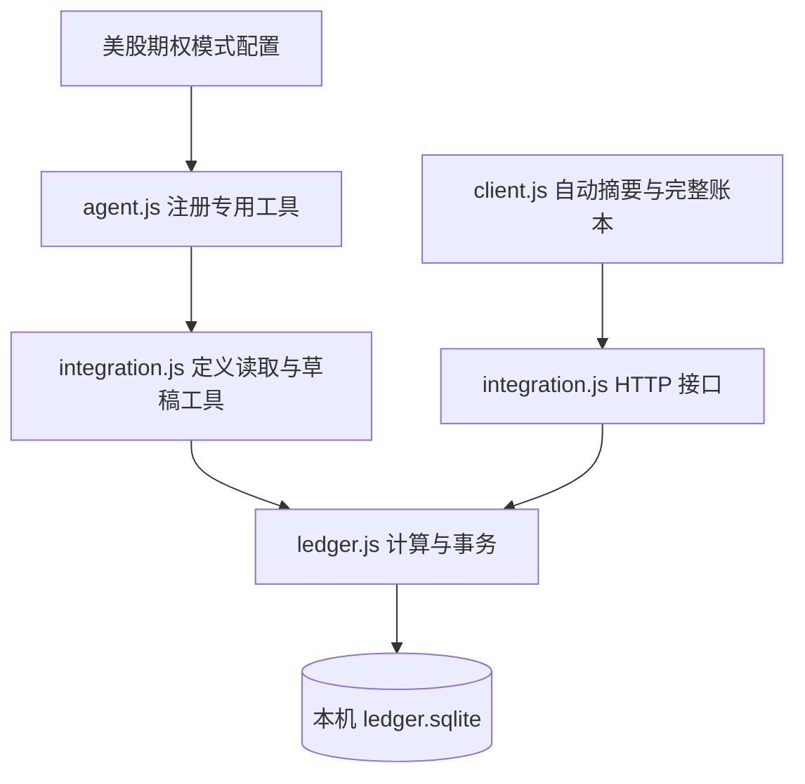
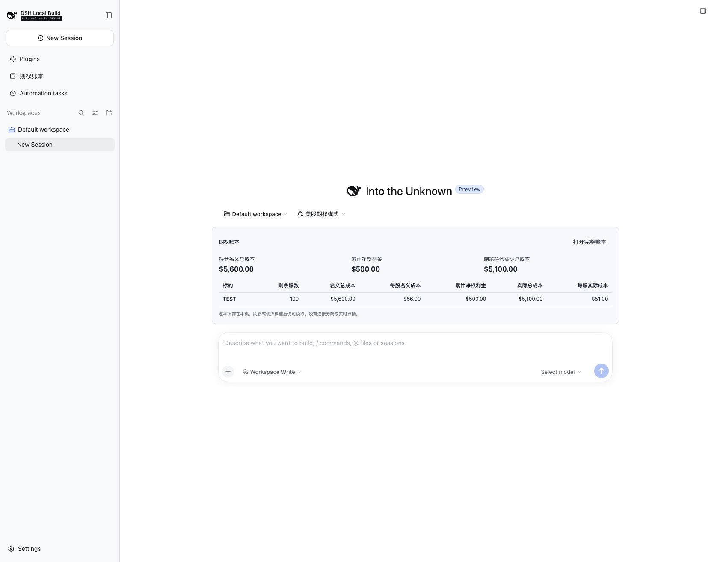

# DeepSeek 美股期权工作台

在 DeepSeek Harness 中选择“美股期权模式”，即可在聊天输入框上方查看剩余股数、累计净权利金、名义成本和实际成本。打开完整账本后，可以录入持仓与成交、处理已经发生的行权、导入导出数据，并确认模型提交的修改草稿。

当前插件版本为 **1.2.2**，已适配并验收 Harness **`dsh-v0.2.1-alpha.2`**。本仓库提供两个自定义插件组合包，使用 Harness 的插件机制安装；官方 Harness 源码、模型服务和个人交易数据由外部环境提供。

## 目录

- [我的美股期权模式是什么](#mode)
- [实现了哪些功能，对应哪些文件](#features)
- [相对于官方 Harness，额外有哪些文件](#files)
- [页面、模型和账本如何连通](#data-flow)
- [安装与使用](#usage)
- [数据位置与公开仓库范围](#data)
- [验证结果与功能范围](#verification)

<a id="mode"></a>
## 我的美股期权模式是什么

模式名称是 **美股期权模式**，模式 ID 是 **`options-trading`**。它围绕现金担保卖出看跌期权（CSP）与备兑看涨期权（Covered Call / CC），按股票标的分别记录期权现金流，并用这些现金流计算剩余股票的策略成本。

模式由“策略提示词 + 专用账本工具 + 自动显示的账本 UI”共同组成。模型负责理解和分析，金额由本地确定性代码计算。模式不绑定 DeepSeek 模型：聊天继续使用 Harness 中选择的模型与供应商，账本页面的录入和计算不需要模型 API。

| 对比项 | Harness 通用模式 | 本仓库的美股期权模式 |
| --- | --- | --- |
| 任务规则 | 使用对应内置模式的通用规则 | 增加 CSP、CC、按标的累计净权利金及成本规则 |
| 账本工具 | 不通过此 preset 挂载专用工具 | 挂载 `options_ledger_read` 和 `options_ledger_propose` |
| 聊天页面 | 不显示本插件的模式专属摘要 | 进入 `options-trading` 后自动显示账本摘要 |
| 完整账本入口 | 安装账本插件后，左侧全局入口仍可使用 | 可从左侧入口或摘要的“打开完整账本”进入 |
| 数据与模型 | 使用同一 `DSH_HOME` 下的账本 | 切换模型不会创建另一份账本 |

### 权利金和成本口径

以下公式由当前账本的 [ledger.js](packages/ledger/ledger.js) 执行；完整规则以 [策略规范 v2](packages/preset/wheel-strategy-spec-v2.md) 为准。

| 指标 | 当前口径 |
| --- | --- |
| 已录入卖出权利金 | 本标的逐笔交易的卖出权利金总和；尚未逐笔录入的历史金额不在此项中 |
| 累计净权利金 | 期初历史净额 + 卖出权利金 − 买回支出 − 期权手续费 |
| 剩余名义总成本 | 手动核对录入的当前股票总成本，或经行权处理更新后的总成本 |
| 每股名义成本 | 剩余名义总成本 ÷ 剩余股数 |
| 剩余实际总成本 | 剩余名义总成本 − 本标的累计净权利金 |
| 每股实际成本 | 剩余实际总成本 ÷ 剩余股数 |

未平仓期权已经收到的现金流也计入净权利金；未成交报价不计入。每个标的独立计算，历史净权利金在股票全部卖出后仍保留，供同一标的下一轮使用。零股时不计算每股成本；缺失持仓时显示待录入，不能把未知数量当成零。实际成本可以为负数，这里表示自定义策略成本，不是税务成本。

组合名义成本和实际成本只加总已核对、股数大于零的标的；组合净权利金汇总所有标的，因此存在已清仓标的时，不能直接用这三个组合指标互相相减代替逐标的计算。

### 行权时怎样更新股票

- **CSP 接货**：增加合约对应股数，名义总成本增加“执行价 × 接货股数 + 股票交割手续费”；已收期权费不重复计入。
- **CC 部分出货**：剩余名义成本 = 原名义总成本 − 交割股票原名义成本 + `max(交割股票原名义成本 − 交割收入, 0)` + 股票交割手续费。即把亏损转给剩余股票，盈利不转入剩余名义成本。
- **CC 全部出清**：剩余股数和名义总成本归零，历史期权净现金流保留。

例：原有 200 股，每股名义成本 $55；以 $54 交割 100 股，剩余名义总成本为 `11000 − 5500 + 100 = $5,600`。若累计净权利金为 $500，则剩余实际总成本为 $5,100，每股实际成本为 $51。

CSP 的现金覆盖、CC 的股票覆盖和执行价严格高于实际成本，是模式的分析约束。现金覆盖及拟议订单检查另有旧版辅助函数，但没有接入当前账本页面成为自动交易风控；当前行权处理会检查 CC 已录入股票是否足够交割。分析规则、记录真实成交与发送订单是不同能力。

<a id="features"></a>
## 实现了哪些功能，对应哪些文件

下面按用户可见行为定位实现。`packages/ledger` 是当前运行的账本；`packages/preset` 提供模式注册、策略规则和保留的旧版资产。

| 功能 | 使用者看到的行为 | 实现文件与入口 |
| --- | --- | --- |
| 注册美股期权模式 | 模式选择器出现“美股期权模式” | [preset/cordis.patch.yml](packages/preset/cordis.patch.yml)：注册 `preset-options-trading` 并配置 persona、工具组合 |
| 自动显示持仓摘要 | 进入模式后，输入框上方出现成本卡片和按标的表格 | [ledger/client.js](packages/ledger/client.js)：`ModeLedger`、`ModeLedgerSummary`，挂入 `conversation.input.dock` |
| 完整账本 UI | 左侧“期权账本”、汇总卡片、持仓表、交易明细和标的筛选 | [ledger/client.js](packages/ledger/client.js)：`Dashboard`、`main` 与 `sidebar.panellist` 插槽 |
| 股数、权利金与成本计算 | 展示总成本、每股成本、累计卖出权利金与净权利金 | [ledger/ledger.js](packages/ledger/ledger.js)：`summarize()`；页面只展示返回结果 |
| 录入及调整持仓、期权交易 | 填写股数、整笔美元金额、日期、状态和备注 | [ledger/client.js](packages/ledger/client.js)：表单；[ledger/ledger.js](packages/ledger/ledger.js)：`positionOf()`、`tradeOf()`、`savePosition`、`saveTrade` |
| 实际行权预览与确认 | 显示行权后股数、名义成本、亏损转移和每股实际成本；确认后统一入账 | [ledger/client.js](packages/ledger/client.js)：行权表单；[ledger/integration.js](packages/ledger/integration.js)：预览接口；[ledger/ledger.js](packages/ledger/ledger.js)：`previewAssignment()`、`assign` |
| 模型读取同一账本 | 聊天调用 `options_ledger_read`，返回真实已录入数据 | [ledger/integration.js](packages/ledger/integration.js)：`ledgerTools()` 定义；[ledger/agent.js](packages/ledger/agent.js)：在期权 preset 内注册 |
| 模型修改先生成草稿 | `options_ledger_propose` 只提交草稿，面板提供确认或拒绝 | [ledger/integration.js](packages/ledger/integration.js)：工具定义；[ledger/ledger.js](packages/ledger/ledger.js)：`propose`、`approve`、`reject`；[ledger/client.js](packages/ledger/client.js)：待确认区域 |
| 本机持久化及自动刷新 | 刷新页面后记录仍在，页面定期重新读取账本 | [ledger/ledger.js](packages/ledger/ledger.js)：SQLite `Ledger`；[ledger/client.js](packages/ledger/client.js)：读取完成后间隔 5 秒再次读取 |
| 并发冲突与重复操作拦截 | 旧表单不能覆盖新记录；重复行权拒绝入账 | [ledger/ledger.js](packages/ledger/ledger.js)：`revision` 检查、事务和行权校验；[ledger/client.js](packages/ledger/client.js)：`formRevision` |
| 修改历史与撤销 | 查看最近修改，撤销上次修改并保留历史记录 | [ledger/ledger.js](packages/ledger/ledger.js)：`history`、`undo`；[ledger/client.js](packages/ledger/client.js)：历史与撤销控件 |
| JSON 导入导出 | 旧版 JSON 或新版备份去重合并；冲突整次拒绝 | [ledger/ledger.js](packages/ledger/ledger.js)：`merge()`；[ledger/client.js](packages/ledger/client.js)：导入表单、`exportData()` |
| 虚构数据演示 | 空账本可查看 TEST 示例，不写入个人数据库 | [ledger/client.js](packages/ledger/client.js)：`DEMO`；[示例截图](docs/mode-summary-example.jpg) 展示独立测试实例 |
| 打包与安装 | 生成两个 `.tgz` 并安装到指定 Harness profile | [scripts/pack.mjs](scripts/pack.mjs)、[scripts/install.mjs](scripts/install.mjs) |
| 自动化回归验证 | 检查金额、行权、冲突、持久化、草稿和接口一致性 | [ledger/test/ledger.test.js](packages/ledger/test/ledger.test.js) |

<a id="files"></a>
## 相对于官方 Harness，额外有哪些文件

这里的“额外”指本仓库随自定义扩展提供的文件，不是对官方 Harness 文件逐个覆盖。旧模式资产也包含在内，并不表示它们都是本次新写的代码。

### 当前插件运行文件

| 文件 | 职责 |
| --- | --- |
| [packages/preset/package.json](packages/preset/package.json) | 模式组合包 `@local/options-trading-agent-preset` 的版本、打包文件和 bundle 入口 |
| [packages/preset/cordis.patch.yml](packages/preset/cordis.patch.yml) | 当前安装入口；注册模式 ID、名称、persona、账本工具及文件/终端等工具 |
| [packages/ledger/package.json](packages/ledger/package.json) | 账本组合包 `@local/options-ledger-dashboard`；声明 Host、Client、Agent 模块及客户端依赖 |
| [packages/ledger/cordis.patch.yml](packages/ledger/cordis.patch.yml) | 在 profile 中插入账本 Host 插件 |
| [packages/ledger/client.js](packages/ledger/client.js) | 当前原生网页 UI、表单、摘要、导入导出、草稿确认和样式 |
| [packages/ledger/integration.js](packages/ledger/integration.js) | `/api/options-ledger` HTTP 接口、请求错误处理和两个模型工具的定义 |
| [packages/ledger/agent.js](packages/ledger/agent.js) | 期权模式专用工具注册及账本使用提示词；支持空会话切换模式后的工具加载 |
| [packages/ledger/ledger.js](packages/ledger/ledger.js) | 当前金额计算、字段验证、行权处理、SQLite 存储、事务、版本冲突及历史 |

### 模式资料与保留的旧版资产

| 文件 | 当前用途与限制 |
| --- | --- |
| [packages/preset/wheel-strategy-spec-v2.md](packages/preset/wheel-strategy-spec-v2.md) | 当前规则说明，明确净权利金与部分 CC 行权的亏损转移口径；运行代码不自动解析此 Markdown |
| [packages/preset/wheel-strategy-spec-v1.md](packages/preset/wheel-strategy-spec-v1.md) | 保留的历史策略原文；与 v2 冲突处以 v2 和当前账本实现为准 |
| [packages/preset/preset.yml](packages/preset/preset.yml) | 保留的名称、说明、顺序元数据；当前安装脚本使用 `cordis.patch.yml`，不直接读取此文件 |
| [packages/preset/agent.cordis.yml](packages/preset/agent.cordis.yml) | 保留的独立模式组合配置；当前安装入口在 `cordis.patch.yml` 中内嵌同类配置，修改时须核对两处 |
| [packages/preset/option-ledger-core.js](packages/preset/option-ledger-core.js) | 旧版独立计算与策略检查函数，含已修正的部分 CC 公式；当前 SQLite 账本不调用它 |
| [packages/preset/option-ledger-workflow.js](packages/preset/option-ledger-workflow.js) | 旧版结构化快照分析适配层 `analyzeWheelSnapshot()`，调用旧 core；未自动注册为当前聊天工具 |
| [packages/preset/option-ledger.html](packages/preset/option-ledger.html) | 旧版独立浏览器账本，使用 localStorage，与当前 SQLite 不自动同步；内嵌的旧 CC 调整公式不符合 v2，仅保留作历史参考和旧数据导出 |

当前成本计算应修改 `packages/ledger/ledger.js`，当前页面应修改 `packages/ledger/client.js`。修改旧 HTML 或旧 core 不会改变 Harness 中的原生账本。旧 HTML 也没有导入已修正的 core，因此不能把 core 的修正当成旧 HTML 已同步修复。

### 工程、说明和验证文件

| 文件 | 职责 |
| --- | --- |
| [README.md](README.md) | 项目总说明、模式定义、功能与文件对应关系 |
| [package.json](package.json) | 项目版本，以及 `test`、`check`、`pack`、`install:harness` 脚本；`private: true` 限制 npm 发布，与 GitHub 仓库是否公开无关 |
| [.gitignore](.gitignore) | 排除依赖、安装包、数据库、环境文件、凭据和备份等本机产物 |
| [scripts/pack.mjs](scripts/pack.mjs) | 对两个组合包执行 `pnpm pack`，输出到 `dist/` |
| [scripts/install.mjs](scripts/install.mjs) | 检查目标路径，打包，备份 profile 文件，通过 Harness CLI 安装两个组合包 |
| [packages/ledger/README.md](packages/ledger/README.md) | 账本插件的使用、存储和限制说明 |
| [packages/preset/README.zh.md](packages/preset/README.zh.md) | 美股期权模式的组合、策略及旧资产说明 |
| [packages/ledger/test/ledger.test.js](packages/ledger/test/ledger.test.js) | 账本自动化测试，使用临时数据库和虚构数据 |
| [docs/mode-summary-example.jpg](docs/mode-summary-example.jpg) | 自动摘要的验收截图，TEST 标的是虚构数据 |

<a id="data-flow"></a>
## 页面、模型和账本如何连通

模式组合包负责给会话安装专用工具；账本组合包提供网页与存储。它们连接同一 `DSH_HOME` 下的数据库，不通过聊天文字或旧 HTML 同步余额。



模型的读取工具查询数据库；修改工具把建议保存为待确认草稿，只有用户在面板确认后，专用账本流程才更新持仓或交易。页面直接录入同样经过 Host 接口与账本校验。策略提示词负责指导模型使用这些工具，金额计算不交给模型估算。

<a id="usage"></a>
## 安装与使用

需要已可运行的 Harness 源码版本 `0.2.1-alpha.2`、支持 `node:sqlite` 的 Node.js，以及 pnpm。安装器同时安装两个自定义组合包；Web profile 还须具备 Harness 的 base 和 web-app 组合包。

在本仓库目录运行，替换为自己的 Harness 和数据目录：

```bash
node scripts/install.mjs --harness /path/to/deepseek-harness --home /path/to/your-dsh-home --profile web
```

安装器备份 profile 的 `package.json`、`pnpm-lock.yaml` 和 `cordis.yml`，但不自动备份账本数据库；也不停止或重启现有服务。已运行实例更新插件后，需要重新启动才能完整加载新代码。继续使用原 `DSH_HOME`，才能读取原配置和账本。

在 Harness 目录启动：

```bash
DSH_HOME=/path/to/your-dsh-home pnpm dsh --profile web --no-open --port 3091
```

1. 打开启动日志中含 token 的完整链接；仅输入端口地址可能出现认证提示。
2. 新建会话，在首次发送消息前选择“美股期权模式”，输入框上方会出现账本区域。
3. 点击“打开完整账本”，录入当前持仓和整笔期权现金流，或导入 JSON。首次账本为空，不会自动获取券商持仓。
4. 实际发生行权后，从未平仓交易点击“记录实际行权”，核对合约乘数及交割股票原成本，预览后确认。
5. 回到期权模式即可查看自动更新的摘要；选择其他模型仍读取同一账本。

下面是独立测试实例的自动摘要，使用虚构 TEST 标的，不代表个人持仓：



<a id="data"></a>
## 数据位置与公开仓库范围

| 安装或运行后产生的文件 | 位置及用途 | 是否作为源码上传 |
| --- | --- | --- |
| 打包产物 | `dist/*.tgz`，安装脚本生成的两个插件包 | 否，可从源码重新生成 |
| 依赖 | `node_modules/`、Harness profile 中的依赖安装目录 | 否 |
| 个人账本 | `$DSH_HOME/data/options-ledger/ledger.sqlite` 及运行时 WAL/SHM 文件 | 否 |
| profile 与凭据 | `$DSH_HOME/profiles/<profile>/` 下的本机配置及依赖清单 | 否 |
| 安装前配置备份 | `$DSH_HOME/backups/before-options-workbench-<时间>/`，可能包含本机凭据 | 否，仅在本机保留 |
| 导出 JSON、启动日志 | 浏览器下载位置或启动时指定位置；可能含交易数据或认证链接 | 否 |

公开仓库包含上面的扩展源码、策略说明、测试及虚构数据截图。提交前仍需核对暂存文件，尤其不要把个人导出的 JSON 放入源码后直接提交；`.gitignore` 不会自动识别所有敏感内容。

面板导出的 JSON 包含持仓、交易及已有行权元数据，不包含完整修改历史或待确认草稿。需要完整数据库备份时，使用 SQLite 备份 API，或关闭服务后备份相关数据库文件；运行期间只复制主文件可能漏掉 WAL 中的数据。旧 HTML 数据需先导出 JSON 再导入，当前插件不读取其 localStorage。

<a id="verification"></a>
## 验证结果与功能范围

以下为版本 1.2.2 的已记录验收结果；本次说明文档调整不改变运行代码。

| 验证层级 | 已观察结果 | 范围 |
| --- | --- | --- |
| 自动化测试 | 22 项通过 | 金额、跨轮累计、行权、去重与冲突、持久化、撤销、草稿确认及 Host/工具共享数据；见 [测试文件](packages/ledger/test/ledger.test.js) |
| 独立实例网页 | 录入 200 股/$11,000 和 CC 权利金 $500，以 $54 交割 100 股后显示名义成本 $5,600、实际成本 $5,100、每股 $51 | 使用虚构数据，验证了录入、预览、保存、模式自动摘要及刷新恢复 |
| 真实模型只读调用 | GPT-5.6 Luna 实际调用 `options_ledger_read`，返回空账本，数据库版本未变化 | 验证模型能够访问同一账本；没有在个人账本中添加测试交易 |

本仓库提供的检查命令：

```bash
npm test
npm run check
npm run pack
```

当前支持的是个人 USD 账本和已发生交易的记录。它不连接券商、不抓取实时行情、不发送订单，也没有自动同步多个证券账户、外汇换算或税务报表。部分合约交割需先拆分交易，多批次股票需人工核对交割成本；单独把期权状态改为“已行权”不会自动调整股票，必须使用行权处理流程或核对后手动调整。导入时没有交易 ID 的旧记录按字段去重，需要核对真实交易笔数。

本页列出的功能以当前实现和验收范围为准；保留的旧版策略检查函数不代表当前页面已经具备相应的自动风控模块。
